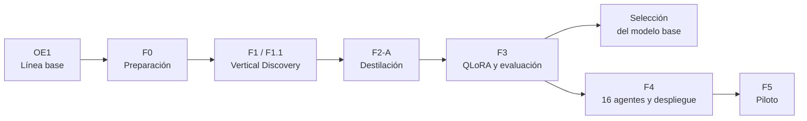
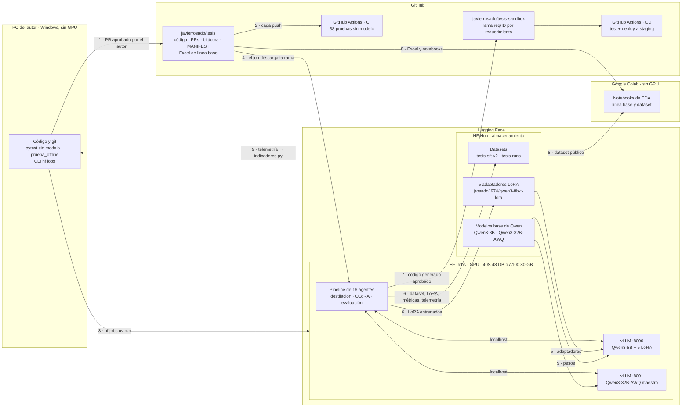
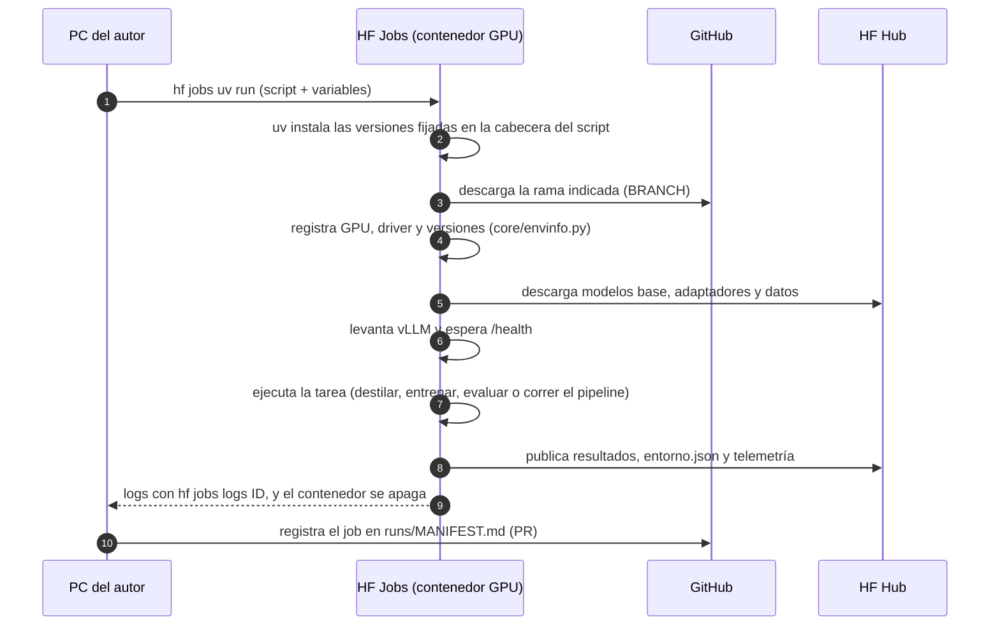
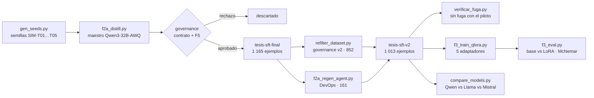
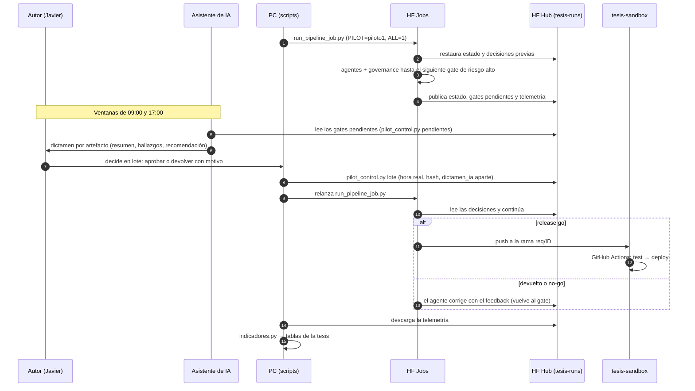

# Pipeline multiagente de IA para el ciclo de vida del requerimiento de software

Implementación de la tesis de **Maestría en Inteligencia Artificial (Universidad Nacional de Ingeniería, Perú)** 

Un requerimiento de negocio entra al pipeline y **16 agentes** lo transforman, dominio por dominio, en historias de usuario, arquitectura, API, modelo de datos, código, pruebas, pipeline de CI/CD y un plan de release. Cada artefacto pasa por un revisor automático (**governance**). Los de riesgo alto esperan la aprobación de una persona. Si el release sale *go*, el servicio se despliega en un repositorio de staging con GitHub Actions.

Todo funciona con **modelos de lenguaje de pesos abiertos** (sin APIs comerciales). Cinco agentes tienen un **adaptador QLoRA propio**, entrenado para esta tesis.

> **Estado al 20/11/2026:** pipeline de 16 agentes implementado y probado de punta a punta; 5 adaptadores entrenados y evaluados; comparación de modelos base ejecutada; despliegue real validado. **Piloto real con 30 requerimientos: del 30/11 al 11/12/2026** (protocolo v2).

---

## Índice

1. [Objetivos de la tesis y dónde está la evidencia](#1-objetivos-de-la-tesis-y-dónde-está-la-evidencia) · [fases](#11-fases-de-la-implementación-objetivo-entrada-procesamiento-y-salida)
2. [Arquitectura](#2-arquitectura): [infraestructura](#21-infraestructura-dónde-corre-cada-componente) · [pipeline](#22-arquitectura-lógica-del-pipeline) · [prueba_offline (antes mock)](#23-proveedor-prueba_offline-antes-mock-pruebas-del-software-sin-modelo) · [jobs](#24-jobs-de-gpu-qué-es-un-job-y-para-qué-se-ejecuta-cada-uno) · [otros flujos](#25-otros-flujos) · [ejemplo de punta a punta](#26-ejemplo-de-ejecución-de-punta-a-punta-sim-p05-r001)
3. [Estructura del repositorio](#3-estructura-del-repositorio)
4. [Hardware utilizado](#4-hardware-utilizado)
5. [Software y versiones](#5-software-y-versiones)
6. [Datos y datasets](#6-datos-y-datasets)
7. [Cómo reproducir cada experimento](#7-cómo-reproducir-cada-experimento)
8. [Resultados obtenidos](#8-resultados-obtenidos)
9. [Errores encontrados y soluciones](#9-errores-encontrados-y-soluciones)
10. [Trazabilidad, bitácora y control de versiones](#10-trazabilidad-bitácora-y-control-de-versiones)
11. [Costos](#11-costos)
12. [Limitaciones conocidas](#12-limitaciones-conocidas)

---

## 1. Objetivos de la tesis y dónde está la evidencia

| Objetivo específico | Qué se hizo | Evidencia en este repositorio |
|---|---|---|
| **OE1** · Diagnosticar el proceso actual | EDA de 150 requerimientos de 6 proyectos: seis indicadores (H1–H6) | [`notebooks/eda_linea_base.ipynb`](notebooks/eda_linea_base.ipynb) · datos en [`data/linea_base/`](data/linea_base/) |
| **OE2/OE3** · Diseñar el pipeline multiagente | 16 agentes con contrato (JSON Schema), criterios de verificación F5, DAG y matriz RACI | [`agents/`](agents/) · [`config/`](config/) · [`contracts/`](contracts/) |
| **OE3** · Implementar y entrenar | Orquestador propio, governance determinista, 5 adaptadores QLoRA, despliegue | [`core/`](core/) · [`jobs/`](jobs/) · [`notebooks/eda_datasets_entrenamiento.ipynb`](notebooks/eda_datasets_entrenamiento.ipynb) |
| **OE4** · Verificar en un piloto | Pruebas de humo, gates manuales y despliegue real hechos; piloto con 30 requerimientos programado | [`runs/MANIFEST.md`](runs/MANIFEST.md) · [`scripts/indicadores.py`](scripts/indicadores.py) |

### 1.1 Fases de la implementación: objetivo, entrada, procesamiento y salida



Cada fase entrega algo que usa la siguiente. Las fechas, decisiones y dificultades están en [`docs/BITACORA.md`](docs/BITACORA.md); cada corrida, en [`runs/MANIFEST.md`](runs/MANIFEST.md).

#### OE1 · Línea base AS-IS (23/10/2026) ✅

| | |
|---|---|
| **Objetivo** | Medir el estado actual del ciclo del requerimiento, antes del pipeline, para tener un punto de comparación |
| **Entrada** | [`data/linea_base/Linea_BaseV2.xlsx`](data/linea_base/): registros reales anonimizados de 6 proyectos, con 150 requerimientos, 83 defectos, 40 despliegues y 666 handoffs |
| **Procesamiento** | EDA en [`notebooks/eda_linea_base.ipynb`](notebooks/eda_linea_base.ipynb): validaciones de integridad, cálculo de los indicadores H1–H6 por agregación y prueba de normalidad (Shapiro-Wilk) |
| **Salida** | Lead time mediano de 66,5 días · 45 % de despliegues fallidos · 34 % de requerimientos con defecto · 1,0 despliegues/mes por proyecto · 0 % de trazabilidad completa · 0 % de handoffs automáticos (30,9 % registrados). El 69,1 % del lead time es espera. |

#### F0 · Preparación del repositorio (18/11/2026) ✅

| | |
|---|---|
| **Objetivo** | Dejar la base técnica y las reglas de trabajo antes de usar modelos |
| **Entrada** | Diseño de los 16 agentes del plan de tesis (fichas F1–F5), restricción del asesor (modelos de pesos abiertos, sin API comerciales) |
| **Procesamiento** | Estructura del repositorio, contratos JSON Schema de cada artefacto, orquestador propio con DAG, capa de proveedores intercambiable, reglas de gobierno en `CLAUDE.md` y CI con el proveedor `prueba_offline` |
| **Salida** | Repositorio con CI en verde; decisiones **D-IMP-1** (piloto con ejecución real) y **D-IMP-3** (Qwen3-8B + un adaptador QLoRA por dominio) |

#### F1 y F1.1 · Vertical Discovery con un modelo real (18/11/2026) ✅

| | |
|---|---|
| **Objetivo** | Probar con un modelo real que la cadena de un dominio funciona: agente → validación → siguiente agente |
| **Entrada** | Requerimiento SIM-P05-R001 y los 3 agentes de Discovery (product-analyst, domain-modeling, ux-ui-copilot) |
| **Procesamiento** | Job en L40S con Qwen3-8B en 4 bits (`jobs/f1_smoke.py`). En F1 governance usaba un LLM; en F1.1 se reemplazó por reglas deterministas |
| **Salida** | 100 % de salidas válidas contra el esquema. La governance con LLM era inconsistente (1 → 8 → 10 hallazgos sobre el mismo artefacto); con reglas deterministas, 3/3 artefactos aprobados de forma reproducible |

#### F2-A · Agentes de los 5 dominios y destilación de datos (19/11/2026) ✅

| | |
|---|---|
| **Objetivo** | Implementar los agentes de los 5 dominios y generar los datos de entrenamiento de los agentes entrenables |
| **Entrada** | Semillas sintéticas de requerimientos (`scripts/gen_seeds.py`, proyectos SIM-T01…T05, distintos del piloto) y el modelo maestro Qwen3-32B-AWQ |
| **Procesamiento** | El maestro ejecuta el pipeline completo sobre cada semilla (`jobs/f2a_distill.py`). Governance acepta o rechaza cada salida; solo se guardan las aprobadas |
| **Salida** | Agentes de los 5 dominios funcionando (7/7 artefactos aprobados en la prueba) y 1 165 ejemplos aprobados (`tesis-sft-final`, privado) |

#### F3 · Ajuste fino QLoRA y evaluación (19–20/11/2026) ✅

| | |
|---|---|
| **Objetivo** | Especializar un agente por dominio y medir, de forma controlada, si el entrenamiento mejora su desempeño |
| **Entrada** | Los 1 165 ejemplos de F2-A, Qwen3-8B y las reglas de governance |
| **Procesamiento** | Governance v2 (6 reglas nuevas) y re-filtrado; regeneración de los ejemplos de DevOps (`jobs/f2a_regen_agent.py`); entrenamiento QLoRA de 5 adaptadores (rango 16, α 32, 2 épocas, semilla 2026, `jobs/f3_train_qlora.py`); evaluación base contra LoRA en la partición de prueba, con una generación por caso y McNemar exacto (`jobs/f3_eval.py`) |
| **Salida** | Dataset `tesis-sft-v2` (1 013 ejemplos, público), 5 adaptadores públicos y resultados: DevOps pasa de 22,2 % a 100 % de aprobación en ronda 0 (p = 0,016), con 26–34 % menos tokens en los agentes de salida larga (sección 8) |

#### Selección del modelo base (20/11/2026) ✅

| | |
|---|---|
| **Objetivo** | Justificar con datos por qué se eligió Qwen3-8B como base |
| **Entrada** | Los 87 casos de prueba de `tesis-sft-v2` y tres candidatos sin ajuste: Qwen3-8B, Llama-3.1-8B-Instruct y Mistral-7B-Instruct-v0.3 |
| **Procesamiento** | Mismo prompt, temperatura 0 y salida restringida para los tres, servidos de uno en uno en la misma GPU (`jobs/compare_models.py`). Regla de decisión en orden: filtro de contrato válido ≥ 95 %, mayor aprobación en ronda 0, desempate por costo, McNemar |
| **Salida** | Qwen3-8B: 100 % de contratos válidos y 82,8 % de aprobación, frente a 60,9 % de Llama (p = 0,0002) y 72,4 % de Mistral (p = 0,039). Llama es más rápido; se reporta |

#### F4 · Pipeline de 16 agentes, aprobaciones y despliegue (20/11/2026) ✅

| | |
|---|---|
| **Objetivo** | Integrar los 16 agentes de punta a punta, con aprobaciones por riesgo y despliegue real, y validar la instrumentación |
| **Entrada** | Requerimientos SIM-P05-R001 a R003, los 5 adaptadores, el maestro y la matriz RACI |
| **Procesamiento** | Pruebas de humo en A100 (`jobs/run_pipeline_job.py`); corrección de 13 fallas; decisión **D-F4-1** (el maestro atiende a backend, QA y code-review); prueba del flujo de gates manuales; despliegue a `tesis-sandbox` |
| **Salida** | Dos requerimientos recorrieron los 16 agentes hasta un release *no-go* justificado (sección 2.6). Despliegue real validado (run 44764311596: test ✔ y deploy ✔). Flujo de aprobación humana probado (opción A). Costo ≈ USD 3,84 |

#### F5 · Piloto (30/11 – 11/12/2026, protocolo v2) ⏳ programado

| | |
|---|---|
| **Objetivo** | Evaluar el pipeline en preproducción, con despliegues reales a *staging*, y contrastar sus indicadores con la línea base (OE4) |
| **Entrada** | Los 30 requerimientos del Squad Fuerza de Ventas ([`data/requerimientos/`](data/requerimientos/)): 27 históricos, emparejados con su registro en la línea base, y 3 nuevos. Los modelos de F3 y F4, el calendario del piloto ([`config/piloto.yaml`](config/piloto.yaml)), el checklist de gates fijado antes del arranque ([`docs/checklists_gates.md`](docs/checklists_gates.md)) y las decisiones humanas del autor |
| **Procesamiento** | `jobs/run_pipeline_job.py` con `PILOT=piloto1` y `GATES_MODE=manual`. El pipeline se detiene en cada gate de riesgo alto; el autor decide en ventanas de 09:00 y 17:00 aplicando el checklist, con un dictamen de IA registrado aparte (`scripts/pilot_control.py lote`). Los releases *go* se despliegan en staging los días de release (01/12, 03/12, 09/12 y 10/12; el feriado del 08/12 pasa al 09/12), un despliegue por requerimiento. Los defectos escapados y los rollback o correcciones se registran con `pilot_control.py defecto` y `despliegue`. Las salidas van a un dataset privado. Tope de gasto: USD 10 |
| **Salida esperada** | Marcas de tiempo `entrada_pipeline`, `go_release` y `deploy_ok_staging` por requerimiento; H1a, H1b, H2, H3, H3′, H4–H6 con `scripts/indicadores.py`; contraste estadístico con la línea base con `scripts/contraste.py` (Wilcoxon, Mann-Whitney, Fisher, McNemar, Holm, IC de Newcombe y Clopper-Pearson) |

**Transversal · Reproducibilidad (20/11/2026) ✅.** Versiones fijadas en cada job, registro de hardware y versiones (`core/envinfo.py`), notebooks de EDA ejecutados, verificación de fuga (`scripts/verificar_fuga.py`) y repetición de la evaluación de DevOps con resultado idéntico (9/9). Detalle en la sección 7.

## 2. Arquitectura

La arquitectura tiene dos vistas. La **infraestructura** (2.1) muestra dónde corre cada cosa: la PC del autor, GitHub, Hugging Face y Colab. La **arquitectura lógica** (2.2) muestra cómo se encadenan los 16 agentes dentro del pipeline. La sección 2.3 explica el proveedor `prueba_offline` (antes `mock`), que prueba el software sin modelo; la 2.4 explica qué hace cada job de GPU, la 2.5 describe los demás flujos (datos y entrenamiento, piloto con aprobaciones humanas, CI, EDA e indicadores) y la 2.6 sigue un requerimiento real de punta a punta.

### 2.1 Infraestructura: dónde corre cada componente



**Componentes**

| Componente | Qué es | Para qué se usa en la tesis | Qué ejecuta o guarda | Evidencia |
|---|---|---|---|---|
| **PC del autor** | Windows x64 sin GPU, con Python 3.10 | Escribir código, correr las pruebas, lanzar los jobs de GPU y calcular los indicadores | `pytest` con el proveedor `prueba_offline` (sin modelo), CLI `hf jobs`, `scripts/indicadores.py` | 38 pruebas en verde |
| **GitHub · `javierrosado/tesis`** | Repositorio privado (este), con acceso por invitación desde el 23/11/2026 | Código fuente, control de versiones y trazabilidad | Agentes, orquestador, jobs, notebooks, `docs/BITACORA.md`, `runs/MANIFEST.md`, Excel de línea base | PR #1 a #9, cada uno aprobado por el autor |
| **GitHub Actions · CI** | Runner `ubuntu-latest`, sin GPU | Comprobar en cada cambio que el código del pipeline funciona | `pytest -q` y un dry-run con el proveedor `prueba_offline`, sin modelo (ver 2.3) | Pestaña *Actions* del repo |
| **Google Colab** | Notebooks en la nube, sin GPU | Que cualquier lector reproduzca el EDA sin instalar nada | `eda_linea_base.ipynb` y `eda_datasets_entrenamiento.ipynb` | Botones "Abrir en Colab" (7.3) |
| **HF Hub** | Almacenamiento de modelos y datos de Hugging Face | Descargar los modelos base y publicar lo que produce la tesis | Pesos de `Qwen/*` (de la organización Qwen); 5 LoRA, `tesis-sft-v2` y `tesis-runs` (públicos, cuenta `jrosado1974`) | Enlaces en la sección 6 |
| **HF Jobs** | Contenedores con GPU que se pagan por segundo y se apagan al terminar | **Toda ejecución real de modelos:** destilación, entrenamiento QLoRA, evaluación, comparación de modelos y pipeline | Dos servidores vLLM en el mismo contenedor (8B + LoRA en `:8000`, maestro 32B en `:8001`) y el pipeline, que les habla por `localhost` | 40 jobs con su id en `runs/MANIFEST.md`; hardware y versiones en `entorno.json` |
| **GitHub · `tesis-sandbox`** | Repositorio de staging | Desplegar el servicio que generan los agentes | Una rama `req/<ID>` por requerimiento | Run 44764311596: test ✔ y deploy ✔ |
| **GitHub Actions · CD** | Runner del sandbox | Probar y desplegar el código generado | Job `test` (pytest) y luego `deploy` | Pestaña *Actions* del sandbox |

**Secuencia de punta a punta** (los números coinciden con las flechas del diagrama)

1. **Desarrollo.** El autor programa en su PC, abre un pull request y lo aprueba; solo así cambia `main`.
2. **Integración continua.** GitHub Actions corre las 38 pruebas con el proveedor `prueba_offline`: verifica el código, no el modelo (2.3).
3. **Lanzamiento.** Desde la PC se lanza un job: `hf jobs uv run --flavor a100-large ... jobs/<script>.py`.
4. **Código versionado.** El job descarga de GitHub la rama indicada; así cada resultado queda atado a una versión del código.
5. **Modelos.** vLLM descarga de HF Hub los pesos base de Qwen y los adaptadores LoRA, y los sirve dentro del contenedor.
6. **Resultados.** Según la fase, el job publica en HF Hub el dataset destilado (F2-A), los adaptadores (F3), las métricas de evaluación o la telemetría del pipeline (F4, F5). El job queda registrado en `runs/MANIFEST.md`.
7. **Despliegue.** Si release-manager decide *go*, el código generado se sube a `tesis-sandbox` y GitHub Actions ejecuta `test` y `deploy`.
8. **EDA reproducible.** Colab lee el Excel desde GitHub y el dataset desde HF Hub, y recalcula las cifras de la línea base y del dataset.
9. **Indicadores.** `scripts/indicadores.py` lee la telemetría descargada y produce las tablas de la tesis.

**Por qué esta distribución**

- **La PC no tiene GPU.** Qwen3-8B necesita unos 16 GB de memoria de GPU solo para sus pesos, y el maestro de 32B unos 20 GB más. Por eso nada que use un modelo corre en la PC.
- **HF Jobs en vez de Colab para las corridas reales:** se lanza por línea de comandos, no depende de una sesión del navegador que se puede cortar y registra el id, el hardware y las versiones de cada corrida. Costo total del proyecto: ≈ USD 27,13.
- **Colab solo para el EDA:** es la forma más simple de que un lector reproduzca las cifras sin instalar nada.
- **Sin APIs comerciales.** Todos los modelos son de pesos abiertos y corren dentro del contenedor; ninguna llamada sale a un proveedor externo.

### 2.2 Arquitectura lógica del pipeline

```
 Requerimiento (brief + restricciones)
        │
        ▼
 ┌──────────────── skill-orchestrator (orquestador propio: DAG, estado, reintentos, gates) ────────────────┐
 │                                                                                                          │
 │  DISCOVERY            ARQUITECTURA           INGENIERÍA              CALIDAD               DEVOPS          │
 │  product-analyst ─┬─► solution-architect ─►  api-designer ─────┐    test-case-generator   cicd-pipeline   │
 │  domain-modeling ─┤   security-compliance    data-model         ├─►  qa-automation   ─►   release-manager │
 │  ux-ui-copilot ───┘                          backend-developer ─┘    code-review           ─► despliegue  │
 │                                                                                                          │
 │  Cada artefacto ─► governance (contrato + criterios F5 + procedencia) ─► gate RACI (humano si riesgo alto) │
 │  Consulta de conocimiento: knowledge-rag (BM25 sobre data/knowledge)                                      │
 └──────────────────────────────────────────────────────────────────────────────────────────────────────────┘
        │
        ▼
 Rama req/<id> en javierrosado/tesis-sandbox ─► GitHub Actions (test + deploy)
```

**Modelos por agente** (definidos en [`config/providers.yaml`](config/providers.yaml)):

| Grupo | Agentes | Modelo |
|---|---|---|
| Entrenados (uno por dominio) | product-analyst, solution-architect, api-designer, test-case-generator, cicd-pipeline | `Qwen/Qwen3-8B` + adaptador QLoRA propio |
| Escriben y revisan código | backend-developer, qa-automation, code-review | `Qwen/Qwen3-32B-AWQ` (sin ajuste) |
| Funcionales restantes | domain-modeling, ux-ui-copilot, security-compliance, data-model, release-manager | `Qwen/Qwen3-8B` base |
| Transversales | governance, skill-orchestrator, knowledge-rag | Sin modelo de lenguaje (reglas, orquestador, BM25) |

Los modelos se sirven con **vLLM** (multi-LoRA y salida restringida por JSON Schema). El modelo es un recurso inyectado por configuración: cambiar de proveedor es editar `config/providers.yaml`.

### 2.3 Proveedor `prueba_offline` (antes `mock`): pruebas del software sin modelo

`prueba_offline` es uno de los proveedores de modelo de `config/providers.yaml`; hasta el 20/11/2026 se llamaba `mock`, nombre que se conserva como alias. **No llama a ningún modelo de lenguaje:** devuelve artefactos de ejemplo predefinidos, guardados en `tests/fixtures/` (16 archivos, uno por agente, para el requerimiento SIM-P05-R001). Por eso sus salidas **no miden la calidad del modelo** y no se usan como resultado. Su único fin es **probar el software del pipeline** (orquestador, contratos, governance, reintentos, telemetría) de forma rápida, gratuita y repetible.

| | Proveedor `prueba_offline` | Proveedor `vllm_local` (real) |
|---|---|---|
| Qué responde | Un artefacto JSON predefinido de `tests/fixtures/<agente>/<req>.json`; no hay modelo | Qwen3-8B (con su LoRA) o Qwen3-32B-AWQ, generando en GPU |
| Dónde corre | PC del autor y GitHub Actions, sin GPU ni red | HF Jobs (L40S o A100) |
| Qué demuestra | Que **el código** funciona: el DAG avanza, governance rechaza lo inválido, hay reintento y escalamiento, la telemetría se escribe | Qué tan bien **el modelo** hace la tarea: aprobación en ronda 0, métricas F5, McNemar, indicadores del piloto |
| Costo y tiempo | USD 0 · ~2 min | Por segundo de GPU · minutos a horas |
| ¿Sus resultados van a la tesis? | **No** | **Sí** |
| Corridas en el MANIFEST | 2 de 44 (F0 y una verificación local de F4; registradas como `mock`, su nombre de entonces) | 40 de 44 en GPU; las otras 2 son pasos locales de datos (fusión y re-filtro) |

**Por qué existe.** El runner de GitHub Actions no tiene GPU. Además, una prueba de software debe dar siempre el mismo resultado: si se usara el LLM real, una variación de un caso del modelo haría fallar la prueba sin que el código tenga ningún error. Con respuestas predefinidas, si una prueba falla, el error está en el código. Es la práctica habitual de pruebas unitarias con dobles de prueba (*test doubles*), que en la jerga de software suelen llamarse *mocks*; se cambió el nombre porque fuera de ese contexto "mock" se entiende como "resultados simulados".

**Cómo comprobar qué proveedor produjo cada dato.** Cada evento de telemetría registra `provider` y `model_id` (`core/telemetry.py`, `core/model_port.py`). Con este proveedor, `model_id` es `artefacto-de-prueba`. En los 24 archivos de telemetría publicados en `tesis-runs` (revisados el 20/11/2026) aparecen `openai_compat` (vLLM, con `model_id` igual al nombre del adaptador, `Qwen/Qwen3-8B` o `Qwen/Qwen3-32B-AWQ`), `deterministic` (governance) y `hf_local` (F1). **Ningún evento proviene del proveedor de prueba** (ni `mock` ni `prueba_offline`).

**Un caso a tener en cuenta.** La tubería de despliegue a `tesis-sandbox` (run 44764311596) se validó con los artefactos predefinidos de este proveedor, para probarla sin gastar GPU. En las pruebas de humo con el modelo real ningún release salió *go*, porque las pruebas del código generado no pasaron. El despliegue de código generado por el LLM se demostrará en el piloto F5, cuando un requerimiento obtenga release *go*.

### 2.4 Jobs de GPU: qué es un job y para qué se ejecuta cada uno

Un **job** es un contenedor con GPU que Hugging Face crea a pedido, ejecuta un script de `jobs/` y destruye al terminar. Se cobra por segundo. Es la única pieza de la arquitectura donde corren los modelos de lenguaje. Se lanza desde la PC con un comando como este (los comandos completos están en 7.4):

```bash
hf jobs uv run --flavor a100-large --secrets HF_TOKEN -e BRANCH=main -e PILOT=piloto1 -e ALL=1 \
  -e RUNS_REPO=jrosado1974/tesis-runs -e "ADAPTERS=$AD" jobs/run_pipeline_job.py   # $AD: lista de adaptadores (ver 7.4)
```

**Qué pasa dentro de un job** (igual en todos los scripts)



**Los 8 scripts de jobs**

| Script | Fase | Para qué se ejecuta | GPU | Lee | Produce | Corrida de ejemplo (MANIFEST) |
|---|---|---|---|---|---|---|
| `f1_smoke.py` | F1 | Primera prueba del vertical Discovery con un modelo real | L40S | Rama + Qwen3-8B | Telemetría en `tesis-runs` | `6afe64ae…` |
| `run_vllm.py` | Pruebas | Ejecutor genérico del pipeline con un modelo servido por vLLM; antecesor de `run_pipeline_job.py`, útil para probar un modelo distinto | L40S | Requerimientos del repo | Telemetría y salidas | — |
| `f2a_distill.py` | F2-A | **Generar los datos de entrenamiento:** el maestro ejecuta el pipeline sobre semillas sintéticas y solo se guardan las salidas que aprueba governance | L40S | Semillas + Qwen3-32B-AWQ | Datasets `tesis-sft-*` | `6aff353d…` |
| `f2a_regen_agent.py` | F3 | Regenerar las salidas de **un** agente cuando una regla nueva de governance invalida las anteriores (se usó para DevOps) | A100 | Entradas ya destiladas + maestro | Archivos de ese agente en `tesis-sft-v2` | `6aff96b6…` + `6affa99f…` (reanudada) |
| `f3_train_qlora.py` | F3 | **Entrenar** un adaptador QLoRA por agente entrenable | L40S | `tesis-sft-v2` + Qwen3-8B | 5 repos `qwen3-8b-*-lora` | `6aff880d…` |
| `f3_eval.py` | F3 | **Evaluar** base contra LoRA en la partición de prueba (una generación, temperatura 0) | L40S | Test + adaptadores | Métricas en `tesis-runs` | `6affa998…`, `6affc5d4…` |
| `compare_models.py` | Selección | **Elegir el modelo base:** Qwen3-8B frente a Llama-3.1-8B y Mistral-7B con los mismos casos | L40S | Test de `tesis-sft-v2` | `runs/compare_models/<job>/` | `6b00d0d3…` |
| `run_pipeline_job.py` | F4–F5 | **Ejecutar el pipeline de 16 agentes** sobre los requerimientos del piloto. Es reanudable: corre hasta el siguiente gate humano pendiente o hasta el despliegue | A100 (8B + maestro) | Estado del piloto + decisiones humanas | Estado, telemetría y despliegue al sandbox | `6b0068f4…` |

### 2.5 Otros flujos

**Flujo de datos y entrenamiento (F2-A → F3).** Cómo se pasa de semillas sintéticas a adaptadores evaluados.



**Flujo del piloto con aprobaciones humanas (F5).** El pipeline se detiene en cada artefacto de riesgo alto y espera la decisión del autor. Las decisiones se registran con su hora real; el dictamen de IA se guarda aparte y nunca reemplaza la decisión humana (opción A).



**Flujo de integración continua.** En cada push o pull request, GitHub Actions instala `requirements.txt`, corre `pytest -q` (38 pruebas) y un dry-run del vertical Discovery con el proveedor `prueba_offline`. Sirve para detectar errores de código antes del merge. No usa GPU ni modelos (2.3).

**Flujo de reproducción del EDA.** El lector abre un notebook en Colab. El notebook descarga el Excel desde GitHub o el dataset desde HF Hub, y recalcula las cifras publicadas sin GPU (7.3).

**Flujo de indicadores.** `scripts/indicadores.py` lee los JSONL de telemetría (cada evento trae `agent`, `provider`, `model_id`, tokens y latencia) y agrupa por clase de modelo: `lora`, `base`, `maestro` y `determinista`. Produce las tablas de la tesis en Markdown o CSV.

### 2.6 Ejemplo de ejecución de punta a punta: SIM-P05-R001

Este ejemplo sigue un requerimiento real del piloto a través de los 16 agentes, con los modelos reales en GPU. Los datos salen de la telemetría publicada de la prueba de humo `humo16d` (job `6b0062d9efaf5e14f4b36f4e`, A100, 20/11/2026). Los artefactos generados se pueden abrir en [`tesis-runs/piloto/humo16d/estado/SIM-P05-R001/output`](https://huggingface.co/datasets/jrosado1974/tesis-runs/tree/main/piloto/humo16d/estado/SIM-P05-R001/output).

**1. Entrada.** Resumen del brief del requerimiento ([`data/requerimientos/SIM-P05-R001/input/brief.md`](data/requerimientos/SIM-P05-R001/input/brief.md)):

> **Consulta de estado del pedido en tiempo real.** Las consultoras llaman al centro de atención para saber dónde está su pedido; el portal muestra solo "en proceso" hasta la facturación. Se pide ver la etapa del pedido (registrado, aprobado, en preparación, despachado, entregado) y la fecha estimada de entrega. Reglas: BR-010 (estados del pedido) y BR-011 (fecha estimada por zona). 5 puntos, Ecuador, app móvil y web.

**2. Ejecución.** Dos formas de correrlo:

```bash
# a) Prueba del software, sin modelo (cualquier lector, ~2 min, sin GPU): recorre el DAG con artefactos predefinidos
PIPELINE_PROVIDER=prueba_offline python scripts/run_pipeline.py --req SIM-P05-R001

# b) Ejecución real con los modelos en GPU (la de este ejemplo; $AD = lista de adaptadores, ver 7.4)
hf jobs uv run --flavor a100-large --timeout 1h --secrets HF_TOKEN \
  -e BRANCH=main -e PILOT=ejemplo -e REQS=SIM-P05-R001 -e RUNS_REPO=$U/tesis-runs \
  -e "ADAPTERS=$AD" -e GATES_MODE=auto -e TEACHER_MODE=always jobs/run_pipeline_job.py
```

**3. Recorrido por los agentes** (cifras tomadas de la telemetría; "rechazos" son devoluciones de governance con su hallazgo)

| # | Dominio | Agente | Modelo que respondió | Llamadas | Rechazos de governance | Tokens generados | Tiempo del modelo | Artefacto producido |
|---|---|---|---|---|---|---|---|---|
| 1 | Discovery | product-analyst | Qwen3-8B + LoRA | 1 | 0 | 974 | 18,9 s | 5 historias de usuario con criterios Given/When/Then |
| 2 | Discovery | ux-ui-copilot | Qwen3-8B base | 1 | 0 | 429 | 6,6 s | Especificación UX |
| 3 | Discovery | domain-modeling | Qwen3-8B base | 1 | 0 | 639 | 9,3 s | Modelo de dominio |
| 4 | Arquitectura | solution-architect | Qwen3-8B + LoRA | 1 | 0 | 1 087 | 20,0 s | Arquitectura de solución |
| 5 | Arquitectura | security-compliance | Qwen3-8B base | 1 | 0 | 1 180 | 19,9 s | Paquete de seguridad |
| 6 | Ingeniería | api-designer | Qwen3-8B + LoRA | 1 | 0 | 847 | 16,8 s | OpenAPI 3.1 (`GET /v1/pedidos/{pedidoId}/estado`) |
| 7 | Ingeniería | data-model | Qwen3-8B base | 3 | 2 | 3 417 | 59,9 s | DDL SQL (`up` y `down`) |
| 8 | Ingeniería | backend-developer | Qwen3-32B-AWQ | 3 | 0 | 3 620 | 114,3 s | Servicio FastAPI (`servicio/app/main.py`) |
| 9 | Calidad | test-case-generator | Qwen3-8B + LoRA | 1 | 0 | 2 167 | 62,9 s | Casos de prueba trazados a los criterios |
| 10 | Calidad | qa-automation | Qwen3-32B-AWQ | 2 | 1 | 2 320 | 89,0 s | Suite pytest ejecutable |
| 11 | Calidad | code-review | Qwen3-32B-AWQ | 3 | 0 | 1 981 | 47,3 s | Revisión de código (ruff, bandit y hallazgos) |
| 12 | DevOps | cicd-pipeline | Qwen3-8B + LoRA | 2 | 1 | 3 100 | 54,8 s | 6 workflows de GitHub Actions (dev, staging, prod) |
| 13 | DevOps | release-manager | Qwen3-8B base | 1 | 0 | 521 | 7,3 s | Plan de release con decisión go/no-go |
| — | Transversal | governance | Sin modelo (reglas) | 34 veredictos | — | — | — | Un archivo `*.decision.json` por artefacto |

Tiempo total de la corrida: **488 s (≈ 8 min)**.

**4. Qué hicieron governance y el ciclo de calidad.** Así se ve el control en acción:

- **data-model**, rondas 0 y 1: rechazado porque *"El DDL generado no se ejecuta en SQLite: FK pedido_id → pedido.pedido_id no existe"*. Con ese feedback lo corrigió y fue aprobado en la ronda 2.
- **qa-automation**, ronda 0: rechazado porque *"Casos sin suite: TC-UNIT-001 … TC-UNIT-005"*. Aprobado en la ronda 1.
- **cicd-pipeline**, ronda 0: rechazado porque el job que ejecuta pytest no hacía checkout del código. Aprobado en la ronda 1.
- **Ciclo de calidad:** las pruebas de QA se ejecutaron contra el servicio. Ciclo 0: 8 pruebas fallidas → el backend se regeneró (remediación 1). Ciclo 1: 9 fallas y 1 hallazgo crítico de code-review → nueva remediación. Ciclo 2: quedaron 5 pruebas fallidas.
- Todos los rechazos quedan auditables en `rechazos.jsonl`, y cada veredicto en `<artefacto>.decision.json`.

**5. Resultado: release *no-go*, sin despliegue.** El plan de release (`release_plan.json`) evaluó su checklist y decidió no desplegar:

| Criterio del release | Cumple | Evidencia |
|---|---|---|
| Pruebas automatizadas en verde | No | 5 de 10 pruebas fallidas |
| 0 hallazgos críticos de revisión | Sí | Críticos: 0 |
| Puertas de seguridad superadas | No | FIND-002, severidad mayor |
| Pipeline de producción con puerta manual | Sí | PIPE-103 con GATE-303 manual |

Telemetría: `deploy_skipped: no-go`. **El pipeline funcionó como debía:** no desplegó código que no pasaba sus pruebas.

**6. Qué se corrigió después de esta corrida:**

- Las 5 pruebas fallaban porque la suite de QA importaba un módulo inexistente (`app.dominio`), y eso contaba como defecto del servicio. Ahora una suite que no se puede importar se invalida y QA debe corregirla (corrección 11 de la prueba de humo F4).
- El hallazgo de seguridad de severidad mayor bloqueaba el release. Se alineó con la política escrita: solo bloquea un hallazgo crítico; mayor y menor van al backlog con su remediación (corrección 12).

**Dos aclaraciones para interpretar el ejemplo**

- Es una **prueba de humo** en modo `GATES_MODE=auto`: los gates de aprobación se resolvieron automáticamente, sin personas. En el piloto F5 (`manual`) esos mismos gates esperan la decisión del autor (flujo de la sección 2.5).
- Los artefactos de este ejemplo los generaron los modelos reales: el `provider` es `openai_compat` y el `model_id` es el adaptador o el modelo de la tabla. No intervino el proveedor `prueba_offline`.

## 3. Estructura del repositorio

```
tesis/
├── agents/<agente>/            Ficha de cada agente: agent.yaml (propósito, entradas, criterios F5, gate),
│                               prompt.md y output.schema.json (contrato de salida)
├── config/
│   ├── dag.yaml                Orden de ejecución de los 16 agentes (con etapas en paralelo)
│   ├── gates.yaml              Matriz RACI y nivel de riesgo por artefacto (modo manual/auto)
│   └── providers.yaml          Qué modelo atiende a cada agente (prueba_offline, vLLM, adaptadores, maestro)
├── contracts/                  Esquemas comunes (solicitud de negocio, procedencia)
├── core/
│   ├── orchestrator.py         Orquestador: DAG, reintentos, gates reanudables, bucle de calidad
│   ├── governance.py           Revisor determinista: contrato + F5 + procedencia, con hallazgos accionables
│   ├── verify.py               Cálculo de las métricas F5 de cada agente
│   ├── render.py               Generación determinista de OpenAPI 3.1 y workflows de GitHub Actions
│   ├── deploy.py               Empaquetado y despliegue a staging (GitHub API + Actions)
│   ├── tools/sandbox.py        DDL en SQLite, servicio FastAPI generado, pytest, ruff, bandit
│   ├── tools/rag.py            knowledge-rag (BM25)
│   ├── adapters/               Proveedores de modelo (prueba_offline, OpenAI-compatible/vLLM, HF local, Ollama)
│   ├── envinfo.py              Registro de hardware y versiones en cada job
│   └── telemetry.py            Eventos JSONL de cada ejecución (insumo de los indicadores)
├── data/
│   ├── linea_base/             Linea_BaseV2.xlsx: datos operativos de la Empresa (OE1)
│   ├── requerimientos/         SIM-P05-R001…R030: los 30 requerimientos del piloto
│   └── knowledge/              Corpus: reglas de negocio, ADRs, políticas, glosario, especificaciones
├── jobs/                       Scripts que se ejecutan en GPU con Hugging Face Jobs (uv, dependencias fijadas)
│   ├── f2a_distill.py          Destilación con el modelo maestro → datos de entrenamiento
│   ├── f3_train_qlora.py       Entrenamiento QLoRA de los adaptadores
│   ├── f3_eval.py              Evaluación base vs. adaptador
│   ├── compare_models.py       Comparación de modelos base (Qwen3-8B, Llama-3.1-8B, Mistral-7B)
│   └── run_pipeline_job.py     Ejecución del pipeline de 16 agentes (pruebas de humo y piloto)
├── notebooks/
│   ├── eda_linea_base.ipynb            EDA de la línea base (OE1), ejecutado
│   ├── eda_datasets_entrenamiento.ipynb EDA del dataset de entrenamiento, ejecutado
│   └── run_pilot.ipynb, finetune_qlora.ipynb   Históricos (etapa con Qwen2.5); no se usan
├── scripts/                    gen_seeds.py (requerimientos sintéticos), refilter_dataset.py, indicadores.py,
│                               pilot_control.py (aprobaciones humanas), run_pipeline.py (local)
├── tests/                      38 pruebas (contratos, governance, DAG, sandbox, gates, despliegue)
├── runs/MANIFEST.md            Registro de todas las corridas (fecha, commit, job, GPU, costo, resultado)
├── docs/BITACORA.md            Bitácora: fechas, decisiones y dificultades
└── CLAUDE.md                   Reglas de gobierno del desarrollo (secretos, PR obligatorio, presupuesto)
```

## 4. Hardware utilizado

| Uso | Hardware | Dónde |
|---|---|---|
| Entrenamiento QLoRA, evaluación, comparación de modelos, pipeline con modelos de 8B | **NVIDIA L40S, 48 GB** (`l40sx1`) | Hugging Face Jobs |
| Modelo maestro Qwen3-32B-AWQ (destilación) y pipeline con 8B + maestro a la vez | **NVIDIA A100, 80 GB** (`a100-large`) | Hugging Face Jobs |
| Orquestación, pruebas automáticas, EDA, notebooks | PC Windows x64 sin GPU (entorno Linux con Python 3.10) | Local |
| Despliegue a staging | Runner `ubuntu-latest` de GitHub Actions | GitHub |

Ejemplo de entorno registrado en un job (`core/envinfo.py`, 20/11/2026): `NVIDIA L40S, 46068 MiB, driver 620.70.06`, Python 3.12.12.

## 5. Software y versiones

**En GPU (jobs, versiones fijadas en la cabecera de cada script de `jobs/`):**

| Componente | Versión | Uso |
|---|---|---|
| Python | 3.12 | Entorno de los jobs (uv) |
| vLLM | 0.34.0 | Servidor de inferencia, multi-LoRA, salida restringida |
| xgrammar | 0.2.8 | Gramática de JSON Schema en vLLM |
| PyTorch | 2.14.0 (instalado por vLLM) | Inferencia |
| transformers | 4.56.2 (entrenamiento) · 5.22.2 (instalado por vLLM en inferencia) | Modelos |
| PEFT · TRL · bitsandbytes | PEFT ≥ 0.13 · TRL 0.19–0.23 · bitsandbytes (4 bits) | QLoRA |
| huggingface_hub | 2.4.0 | Datos, modelos y jobs |
| jsonschema · openapi-spec-validator | 4.26.0 · 0.9.0 | Contratos y validación de OpenAPI |

**Modelos:** `Qwen/Qwen3-8B` (Apache 2.0), `Qwen/Qwen3-32B-AWQ` (Apache 2.0), y para la comparación `meta-llama/Llama-3.1-8B-Instruct` (licencia Llama 3.1) y `mistralai/Mistral-7B-Instruct-v0.3` (Apache 2.0).

**Local** (`requirements.txt`): Python 3.10, jsonschema 4.26.0, PyYAML 6.0.3, pytest 9.2.0, openapi-spec-validator 0.9.0, FastAPI 0.162.5, httpx 0.28.1, ruff 0.17.6, bandit 1.9.4, huggingface_hub 2.4.0. Notebooks: pandas, matplotlib, scipy, tokenizers, jsonschema.

**Configuración del entrenamiento:** QLoRA en 4 bits (NF4), rango 16, α 32, 2 épocas, tasa de aprendizaje 2e-4 con coseno, pérdida solo sobre la respuesta, longitud máxima de 8 192 tokens (12 288 en DevOps), **semilla 2026**. Inferencia de evaluación: temperatura 0, una generación por caso, salida restringida por JSON Schema, `enable_thinking=false` en Qwen3.

## 6. Datos y datasets

| Dataset | Contenido | Uso | Acceso |
|---|---|---|---|
| [`data/linea_base/Linea_BaseV2.xlsx`](data/linea_base/) | 6 proyectos, 150 requerimientos, 83 defectos, 40 despliegues, 666 handoffs | Línea base OE1 | **Privado** (repositorio con acceso por invitación) |
| [`data/requerimientos/`](data/requerimientos/) | 30 requerimientos del Squad Fuerza de Ventas (SIM-P05) | Piloto y pruebas de humo (nunca se usaron para entrenar) | **Privado** (repositorio con acceso por invitación) |
| [`data/knowledge/`](data/knowledge/) | Reglas de negocio, ADRs, políticas, glosario, especificaciones | Corpus de knowledge-rag | Público |
| [jrosado1974/tesis-sft-v2](https://huggingface.co/datasets/jrosado1974/tesis-sft-v2) | **1 013 ejemplos** (train 810 · val 116 · test 87) de 5 agentes | Entrenamiento y evaluación | Público |
| [jrosado1974/tesis-runs](https://huggingface.co/datasets/jrosado1974/tesis-runs) | Resultados de evaluación, comparación, telemetría y estado de corridas | Evidencia de resultados | **Privado** desde el 23/11/2026 (contiene artefactos de requerimientos de la Empresa; acceso por invitación) |
| jrosado1974/tesis-piloto | Telemetría, estado, aprobaciones y registros del piloto F5 (`RUNS_REPO` del piloto) | Evidencia del piloto | **Privado** (datos de la Empresa; acceso por invitación) |
| tesis-sft-pilot, tesis-sft, tesis-sft-r2, tesis-sft-final | Etapas intermedias de la destilación | Linaje de tesis-sft-v2 | Privado |

**Cómo se generaron los datos de entrenamiento (linaje):** `scripts/gen_seeds.py` crea requerimientos sintéticos → el modelo maestro `Qwen3-32B-AWQ` ejecuta el pipeline (`jobs/f2a_distill.py`) → governance acepta o rechaza cada salida → 1 165 ejemplos aprobados (`tesis-sft-final`) → re-filtrado con governance v2 (852) + 161 ejemplos de DevOps regenerados (`jobs/f2a_regen_agent.py`) = **1 013** (`tesis-sft-v2`). Las particiones son por requerimiento: no hay fuga entre train/val/test ni con el piloto (verificado en el notebook de EDA).

### 6.1 Datos sintéticos y datos reales

**Los datos sintéticos se usan solo para entrenar; todo lo que mide el impacto usa datos reales.** Detalle, justificación y referencias en [`docs/DATOS.md`](docs/DATOS.md).

| Uso | Datos | Naturaleza |
|---|---|---|
| Entrenar y evaluar los adaptadores (F3) | `tesis-sft-v2` (semillas SIM-T01…T05 destiladas por el maestro) | Sintético, validado con JSON Schema y governance |
| Línea base AS-IS (OE1) | `Linea_BaseV2.xlsx` | Real, anonimizado |
| Piloto (OE4) | `data/requerimientos/SIM-P05-*` | Real (caso del Squad Fuerza de Ventas) |

Por qué: no existe un corpus etiquetado con los contratos de estos agentes y los requerimientos de la Empresa son confidenciales; generar, filtrar y ajustar es el esquema de Self-Instruct (Wang et al., 2023) y de la destilación (Hsieh et al., 2023).

Verificación de que el piloto no está en el entrenamiento (`python scripts/verificar_fuga.py`, ~5 s, sin GPU): 0 identificadores y 0 títulos en común; el requerimiento del piloto más parecido a uno de entrenamiento tiene similitud 0,655, menor que la que hay entre requerimientos de entrenamiento distintos (mediana 0,67). Resultado: **sin fuga**.

**Adaptadores entrenados (públicos):** [qwen3-8b-product-analyst-lora](https://huggingface.co/jrosado1974/qwen3-8b-product-analyst-lora) · [qwen3-8b-solution-architect-lora](https://huggingface.co/jrosado1974/qwen3-8b-solution-architect-lora) · [qwen3-8b-api-designer-lora](https://huggingface.co/jrosado1974/qwen3-8b-api-designer-lora) · [qwen3-8b-test-case-generator-lora](https://huggingface.co/jrosado1974/qwen3-8b-test-case-generator-lora) · [qwen3-8b-cicd-pipeline-lora](https://huggingface.co/jrosado1974/qwen3-8b-cicd-pipeline-lora)

## 7. Cómo reproducir cada experimento

### 7.1 Requisitos

| Para | Necesitas |
|---|---|
| Pruebas locales y EDA | Python 3.10+ y git. Sin GPU ni cuentas |
| Experimentos en GPU | Cuenta de Hugging Face con saldo para [Jobs](https://huggingface.co/docs/huggingface_hub/guides/jobs) (o plan PRO), token con permiso de escritura y la CLI `hf` |
| Llama-3.1-8B en la comparación | Aceptar su licencia en su página de Hugging Face |
| Despliegue a staging | Un repositorio de GitHub propio y un token con permisos Contents, Actions y Workflows |

### 7.2 Instalación y pruebas locales (sin GPU, ~2 min)

```bash
git clone https://github.com/javierrosado/tesis.git && cd tesis
python -m venv .venv && source .venv/bin/activate      # Windows: .venv\Scripts\activate
pip install -r requirements.txt
pytest -q                                               # resultado esperado: 38 passed
PIPELINE_PROVIDER=prueba_offline python scripts/run_pipeline.py --req SIM-P05-R001   # prueba del software con artefactos predefinidos (ver 2.3); no usa ningún modelo
```

### 7.3 EDA (sin GPU, en Colab o local)

> El repositorio es privado desde el 23/11/2026 porque contiene datos anonimizados de la Empresa (Plan V2.7, 4.6). Para abrir los notebooks en Colab hay que autorizar el acceso a GitHub con una cuenta invitada; también se pueden ejecutar en local tras clonar el repositorio.

| Notebook | Abrir en Colab | Resultado esperado |
|---|---|---|
| Línea base (OE1) | [eda_linea_base.ipynb](https://colab.research.google.com/github/javierrosado/tesis/blob/main/notebooks/eda_linea_base.ipynb) | 66,5 días · 45 % · 34 % · 1,0 · 0 % · 0 % / 30,9 % |
| Dataset de entrenamiento | [eda_datasets_entrenamiento.ipynb](https://colab.research.google.com/github/javierrosado/tesis/blob/main/notebooks/eda_datasets_entrenamiento.ipynb) | 1 013 ejemplos · 100 % válidos · 0 requerimientos en común entre particiones |
| Separación piloto / entrenamiento | `python scripts/verificar_fuga.py` (local, sin GPU) | 0 ids · 0 títulos · similitud máx. 0,655 · SIN FUGA |

### 7.4 Experimentos en GPU (Hugging Face Jobs)

Prepara tu entorno (una vez):

```bash
pip install -U huggingface_hub && hf auth login
export U=<tu_usuario_hf>
hf repo create $U/tesis-runs --repo-type dataset     # aquí se guardan tus resultados
```

**a) Evaluación base vs. adaptador** (usa los adaptadores públicos; L40S, ~10 min por agente, ~USD 0,3):

```bash
hf jobs uv run --flavor l40sx1 --timeout 1h --secrets HF_TOKEN \
  -e BRANCH=main -e SFT_REPO=jrosado1974/tesis-sft-v2 -e RUNS_REPO=$U/tesis-runs \
  -e "ADAPTERS=cicd-pipeline-agent=jrosado1974/qwen3-8b-cicd-pipeline-lora" \
  jobs/f3_eval.py
# para los 5 agentes, añade los otros pares agente=repo separados por espacio en ADAPTERS
```

Resultado esperado (DevOps): adaptador **9/9 aprobados (100 %)**, ~1 800 tokens, ~95 s por respuesta; base entre 2/9 y 3/9.

**b) Comparación de modelos base** (L40S, ~30 min, ~USD 0,9):

```bash
hf jobs uv run --flavor l40sx1 --timeout 2h --secrets HF_TOKEN \
  -e BRANCH=main -e SFT_REPO=jrosado1974/tesis-sft-v2 -e RUNS_REPO=$U/tesis-runs \
  jobs/compare_models.py
```

Resultado esperado: aprobación en ronda 0 de Qwen3-8B ≈ 83 %, Llama-3.1-8B ≈ 61 %, Mistral-7B ≈ 72 %.

**c) Entrenamiento QLoRA** (publica los adaptadores en tu cuenta; L40S, 15–35 min por agente):

```bash
hf jobs uv run --flavor l40sx1 --timeout 3h --secrets HF_TOKEN \
  -e SFT_REPO=jrosado1974/tesis-sft-v2 -e AGENTS=product-analyst-agent \
  jobs/f3_train_qlora.py
# DevOps: -e AGENTS=cicd-pipeline-agent -e MAX_LEN=12288
```

Resultado esperado: pérdida de validación cercana a la de la tabla de la sección 8 (p. ej., product-analyst ≈ 0,18).

**d) Pipeline de 16 agentes** (A100: Qwen3-8B + adaptadores + maestro; ~15 min para 3 requerimientos):

```bash
AD="product-analyst-agent=jrosado1974/qwen3-8b-product-analyst-lora solution-architect-agent=jrosado1974/qwen3-8b-solution-architect-lora api-designer-agent=jrosado1974/qwen3-8b-api-designer-lora test-case-generator-agent=jrosado1974/qwen3-8b-test-case-generator-lora cicd-pipeline-agent=jrosado1974/qwen3-8b-cicd-pipeline-lora"
hf jobs uv run --flavor a100-large --timeout 1h --secrets HF_TOKEN \
  -e BRANCH=main -e PILOT=prueba1 -e REQS=SIM-P05-R001,SIM-P05-R002,SIM-P05-R003 \
  -e RUNS_REPO=$U/tesis-runs -e "ADAPTERS=$AD" -e GATES_MODE=auto -e TEACHER_MODE=always \
  jobs/run_pipeline_job.py
# Gates humanos: GATES_MODE=manual y luego
#   python scripts/pilot_control.py pendientes --pilot prueba1
#   python scripts/pilot_control.py decidir --pilot prueba1 --req SIM-P05-R001 --artefacto user_story_set --decision approved
# Despliegue real: añade --secrets GITHUB_TOKEN -e DEPLOY_REPO=<tu_usuario>/<tu_repo_staging>
```

**e) Indicadores desde la telemetría:**

```bash
python scripts/indicadores.py <carpeta>/telemetria/*.jsonl --md indicadores.md
```

**f) Hipótesis del piloto y contraste con la línea base (protocolo v2):**

```bash
# 1) indicadores H1–H6 por requerimiento (telemetría + registros de defectos escapados y post-despliegue + estado)
python scripts/indicadores.py <carpeta>/telemetria/*.jsonl <carpeta>/registros/*.jsonl \
  --estado <carpeta>/estado --piloto piloto1 --csv-req piloto_por_req.csv --md indicadores.md
# 2) contraste estadístico contra Linea_BaseV2.xlsx (G1′ emparejado y G1*)
python scripts/contraste.py --piloto piloto_por_req.csv --md contraste.md --json contraste.json
```

### 7.5 ¿Qué tan comparables serán los resultados?

- **Deterministas (idénticos):** EDA de la línea base, EDA del dataset, governance, pruebas locales.
- **Entrenamiento:** semilla fija (2026); se esperan pérdidas muy cercanas, no idénticas bit a bit.
- **Inferencia con vLLM a temperatura 0:** el procesamiento por lotes puede cambiar **1–2 casos** entre corridas. Reproducción verificada el 20/11/2026 (job `6b00e7664fdc5ab3c55c332b`): adaptador de DevOps **9/9, idéntico a F3** (1 805 vs. 1 810 tokens; 94,7 vs. 94,4 s); el modelo base pasó de 2/9 a 3/9.
- Cada job imprime y guarda su entorno (`ENTORNO …` en el log y `entorno.json` con los resultados): GPU, driver y versiones.

## 8. Resultados obtenidos

**Entrenamiento y evaluación (partición de prueba, 87 casos):**

| Agente (dominio) | Ejemplos entren./val./prueba usados | Pérdida de validación | Aprobación en ronda 0: base → LoRA | McNemar p | Tokens de salida |
|---|---|---|---|---|---|
| product-analyst (Discovery) | 211 / 29 / 24 | 0,178 | 91,7 % → 95,8 % | 1,000 | 609 → 602 |
| solution-architect (Arquitectura) | 143 / 20 / 18 | 0,211 | 100 % → 94,4 % | 1,000 | 1 247 → 901 |
| api-designer (Ingeniería) | 177 / 26 / 22 | 0,069 | 90,9 % → 100 % | 0,500 | 1 688 → 1 109 |
| test-case-generator (Calidad) | 129 / 22 / 14 | 0,115 | 92,9 % → 92,9 % | 1,000 | 1 770 → 1 240 |
| cicd-pipeline (DevOps) | 136 / 16 / 9 | 0,028 | **22,2 % → 100 %** | **0,016** | 2 431 → 1 810 |

**Comparación de modelos base (mismos 87 casos, sin ajuste):**

| Indicador | Qwen3-8B | Llama-3.1-8B | Mistral-7B |
|---|---|---|---|
| Contrato válido | **100 %** | 98,9 % | 93,1 % |
| Aprobación en ronda 0 | **82,8 %** | 60,9 % | 72,4 % |
| McNemar (Qwen vs. otro) | — | p = 0,0002 | p = 0,039 |
| Tokens / latencia | 1 427 / 64 s | **1 070 / 44 s** | 1 833 / 80 s |

**Pipeline:** dos requerimientos recorrieron los 16 agentes hasta un release *no-go* justificado por pruebas fallidas; despliegue real en staging con GitHub Actions ([run 44764311596](https://github.com/javierrosado/tesis-sandbox/actions/runs/44764311596): test ✔ y deploy ✔); flujo de aprobación humana probado en GPU (pausa → dictamen → devolución → reproceso).

**Definiciones:** *contrato válido* = la salida cumple el JSON Schema del agente; *aprobación en ronda 0* = la primera respuesta, sin correcciones, cumple contrato + criterios F5 + procedencia (equivale a la *accuracy* de un agente generativo); *McNemar exacto* compara dos modelos sobre los mismos casos usando solo los casos donde discrepan.

## 9. Errores encontrados y soluciones

| # | Fase | Error | Solución | Resultado |
|---|---|---|---|---|
| 1 | F1 | Governance con LLM inconsistente (1 → 8 → 10 hallazgos) | Governance determinista | 3/3 artefactos aprobados |
| 2 | F2-A | Salidas truncadas a 2 048 tokens | Límite de 4 096–6 144; JSON inválido = rechazo | Sin truncamientos |
| 3 | F2-A | YAML dentro de JSON degeneraba | Diseño estructurado + render determinista (`core/render.py`) | 7/7 aprobados |
| 4 | F2-A | vLLM rechazaba el esquema (HTTP 400) | Esquema adaptado a la gramática + reintento | Salida estable |
| 5 | F3 | Regeneración perdida por timeout | Script reanudable con publicación incremental | 161 ejemplos de DevOps |
| 6 | F3 | Entrenamiento sin gradiente (4 bits) | `prepare_model_for_kbit_training` + checkpointing no reentrante | Entrenamiento correcto |
| 7 | F3 | 128/150 ejemplos de DevOps descartados por longitud | Límite de 12 288 tokens | Pérdida de validación 0,028 |
| 8 | F4 | Código del backend inválido (comillas, DB) | DB con `json.loads`, comillas simples, firmas y tablas en la entrada | Servicio importable |
| 9 | F4 | El 8B base no producía código que pasara pruebas | Maestro Qwen3-32B para backend, QA y code-review | Aprobación en ronda 0 |
| 10 | F4 | Job de despliegue sin checkout | Adaptación determinista registrada en el empaquetado | test ✔ y deploy ✔ |

## 10. Trazabilidad, bitácora y control de versiones

- **Bitácora** con fechas, decisiones y dificultades: [`docs/BITACORA.md`](docs/BITACORA.md).
- **Registro de corridas:** [`runs/MANIFEST.md`](runs/MANIFEST.md) — 44 corridas con fecha, fase, commit/rama, id del job, GPU, duración, costo, modelo, dataset, semilla, métricas y estado. Los logs de cada job se consultan con `hf jobs logs <id>`.
- **Control de versiones:** una rama por fase y merge a `main` solo por pull request revisado por el autor: [PR #1–#8](https://github.com/javierrosado/tesis/pulls?q=is%3Apr).
- **Versión que produjo cada resultado:** la columna *Commit* del MANIFEST indica la rama o el commit; los jobs descargan exactamente esa rama de GitHub al iniciar.
- **Telemetría por requerimiento:** cada ejecución de agente, veredicto de governance, gate humano y despliegue queda en `tesis-runs/piloto/<piloto>/telemetria/*.jsonl`.

## 11. Costos

| Fase | GPU (USD) |
|---|---|
| F1 Vertical Discovery | 0,63 |
| F2-A Destilación | 9,68 |
| F3 Entrenamiento y evaluación | 11,42 |
| F4 Pipeline de 16 agentes | 4,27 |
| Comparación de modelos + verificación de reproducibilidad | 1,13 |
| **Total** | **≈ 27,13** |

## 12. Limitaciones conocidas

- Los datos de entrenamiento son sintéticos (la línea base y el piloto son reales; ver [`docs/DATOS.md`](docs/DATOS.md)) y sus respuestas de referencia vienen del maestro: el techo del adaptador es el maestro filtrado por governance.
- La partición de prueba de F3 también es sintética: F3 mide el efecto controlado del entrenamiento; la evidencia en contexto real la aporta el piloto.
- Particiones de prueba pequeñas (9–24 casos por agente).
- Qwen3-8B es de la misma familia que el maestro, lo que le da ventaja en el ajuste fino.
- Los tres agentes de código usan el maestro sin ajustar; ahí no se mide el efecto del entrenamiento.
- Las aprobaciones humanas del piloto las ejerce una sola persona en todos los roles.
- El entorno de despliegue es staging; no hay incidentes de producción.

---

Licencia del código: uso académico. Modelos y datos de terceros bajo sus propias licencias (Qwen: Apache 2.0; Llama 3.1: Llama Community License; Mistral: Apache 2.0).
